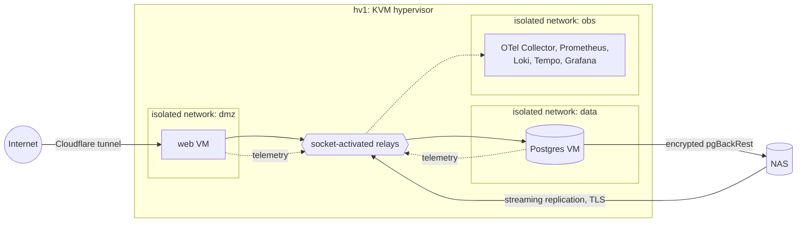

# Homelab

Ansible for a single-hypervisor homelab: isolated VMs, observability, Postgres with off-host recovery, and
CrowdSec bans shared with Cloudflare. This is a curated copy of a private working repo. Host names, addresses
and domains are examples.



## Highlights

| Role | What it does |
|---|---|
| [vm_isolation](roles/vm_isolation) | Isolated libvirt networks with a drop-only nftables table; systemd-socket-proxyd relays are the only way across ([write-up](docs/vm-isolation.md)) |
| [postgres_server](roles/postgres_server), [tools/nas1-postgres](tools/nas1-postgres) | Postgres 18 with pgBackRest (local and encrypted off-host repositories), a streaming replica on a NAS, and a restore script ([write-up](docs/postgres-recovery.md)) |
| [observability](roles/observability), [otel_agent](roles/otel_agent) | OTel Collector, Prometheus, Loki, Tempo and Grafana; agents that can't spoof their origin; alerts as code ([write-up](docs/alerting.md)) |
| [crowdsec](roles/crowdsec), [crowdsec_cf_sync](roles/crowdsec_cf_sync) | Local CrowdSec bans mirrored into Cloudflare IP Lists, with safety limits and a never-ban list |
| [vm_tools](roles/vm_tools) | `vm exec/shell/push/pull` through the QEMU guest agent, so isolated VMs need no SSH path |
| [disk_health](roles/disk_health) | ZFS and SMART monitoring that mails on problems, staggered long self-tests |
| [docker_inventory_proxy](roles/docker_inventory_proxy) | Read-only allowlist in front of the Docker socket (no inspect, so no environment secrets) |
| [docker_prune](roles/docker_prune), [host_firewall](roles/host_firewall) | Bounded Docker clean-up; host services limited to the LAN interface |

The other roles (ZFS, libvirt, Cockpit, Samba, Let's Encrypt and so on) build the hypervisor itself.

## Use

These roles document a working design more than they aim to be drop-in. Copy what's useful.

```bash
ansible-galaxy collection install -r requirements.yml
cp group_vars/all/vault.yml.example group_vars/all/vault.yml && ansible-vault encrypt group_vars/all/vault.yml
ansible-playbook -i inventory.example.yml services.yml --ask-vault-pass --check --diff
```

`site.yml` configures the hypervisor, `services.yml` the roles above.

## Checks

CI runs a secret scan and Ansible syntax checks. The export is allowlist-based and fails if it finds a real host
name, address, domain or vaulted value.
